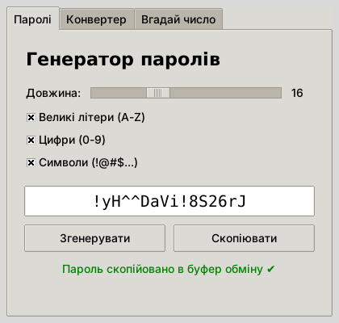
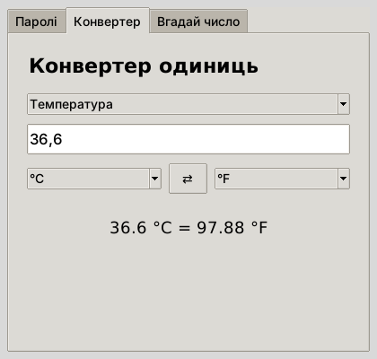
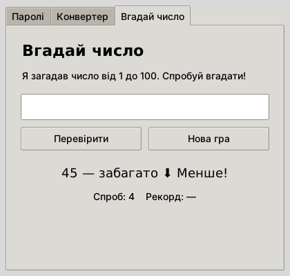

# PocketTools

Невеликий віконний застосунок на Python (Tkinter) з трьома корисними інструментами:

- **🔑 Генератор паролів** — довжина від 4 до 40 символів, вибір великих літер, цифр і символів, копіювання в буфер обміну одним кліком.
- **📏 Конвертер одиниць** — довжина, вага й температура, миттєвий перерахунок під час введення.
- **🎲 Вгадай число** — комп'ютер загадує число від 1 до 100 і підказує «більше / менше», рахує спроби й рекорд.

## Скріншоти





## Запуск

Готовий файл: `PocketTools.exe` — просто запустіть його (Python не потрібен).

Запуск із вихідного коду:

```
python main.py
```

## Як зібрати .exe

Двічі клацнути `build.bat` або виконати вручну:

```
pip install pyinstaller
pyinstaller --onefile --windowed --name PocketTools main.py
```

Готовий файл з'явиться в папці `dist/` (`build.bat` одразу копіює його в корінь репозиторію).
